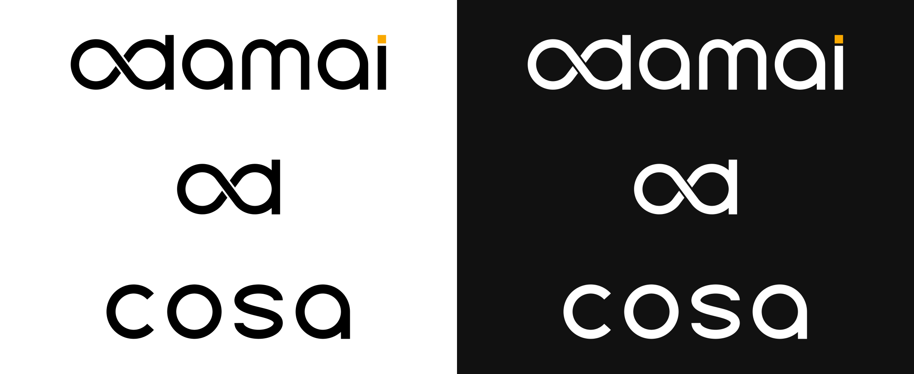
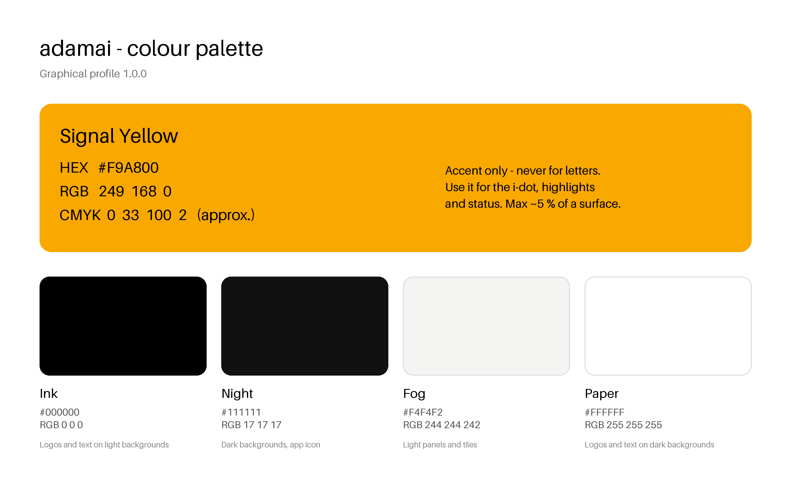
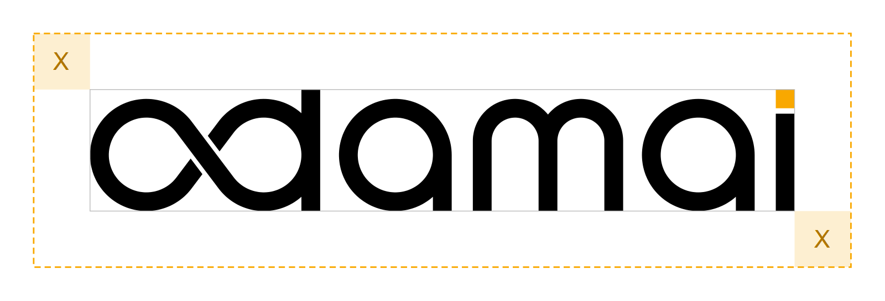
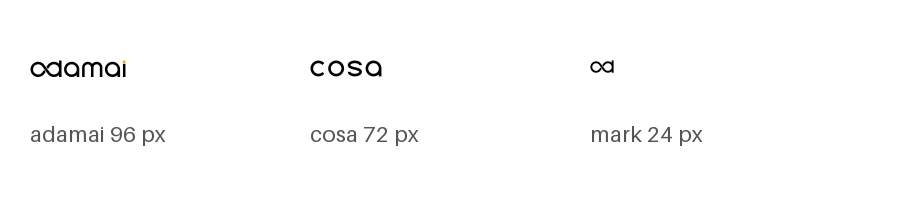
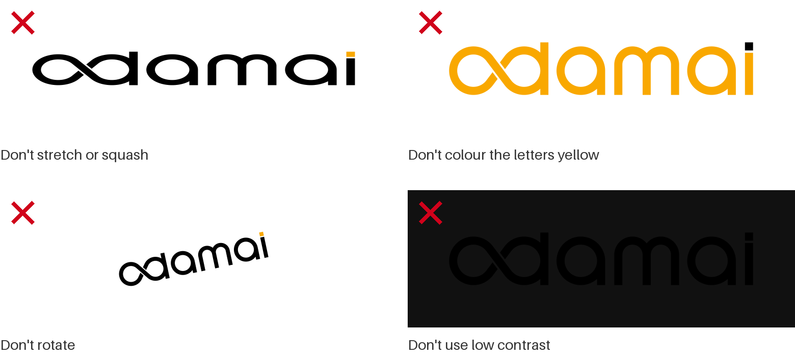

# adamai graphical profile

**Release 1.0.0** · logos, colours and usage rules for **adamai** and its product **cosa**
(continuous assurance as code).



Every logo in this repository is *constructed*, not drawn: it is generated from a few circles,
arcs and straight strokes by the Python code in [`tools/`](tools/). The SVG files are the masters;
everything else is derived from them.

---

## Contents

| Asset | Use it for | Files |
|---|---|---|
| **adamai wordmark** | The company logo. First choice everywhere. | [`logos/adamai/`](logos/adamai/) |
| **adamai mark** (∞d) | Avatars, app icons, favicons, small spaces where the wordmark won't fit. | [`logos/adamai-mark/`](logos/adamai-mark/) |
| **cosa wordmark** | The product logo. | [`logos/cosa/`](logos/cosa/) |
| **Colour palette** | Colours and design tokens (JSON, CSS, SCSS). | [`colors/`](colors/) |
| **Guideline images** | Clear space, minimum size, misuse. | [`docs/`](docs/) |
| **Generator** | Rebuilds every asset from the geometry. | [`tools/`](tools/) |

```
adamai-brand/
├── logos/
│   ├── adamai/        svg/  png/       adamai-primary · -reversed · -black · -white
│   ├── adamai-mark/   svg/  png/  icons/   mark, app icons, favicon.ico/.svg, apple-touch-icon
│   └── cosa/          svg/  png/       cosa-black · -white
├── colors/            palette.png  colors.json  colors.css  colors.scss
├── docs/              overview, clear space, minimum size, misuse, history/
├── tools/             geometry.py  build.py
├── CHANGELOG.md  LICENSE.md  Makefile  requirements.txt
```

---

## Logos

### adamai

The infinity forms the first two letters, **a** and **d**: one continuous line that weaves over
itself, standing for continuous assurance. The **i** carries a square dot in Signal Yellow.

| Variant | Background | File |
|---|---|---|
| `adamai-primary` | Light | Black letters, yellow dot — **the default** |
| `adamai-reversed` | Dark | White letters, yellow dot |
| `adamai-black` | Light, one-colour print | All black |
| `adamai-white` | Dark, one-colour print | All white |

### adamai mark

The "ad" from the wordmark on its own. Use it only where the full wordmark does not fit, or where
the brand is already established in context (social avatars, app icons, browser tabs).

`logos/adamai-mark/icons/` contains ready-made app icons (dark and light, 16–512 px),
`favicon.ico` (16/32/48), an adaptive `favicon.svg` that switches to white in dark mode, and
`apple-touch-icon.png`.

```html
<link rel="icon" href="/favicon.ico" sizes="48x48">
<link rel="icon" href="/favicon.svg" type="image/svg+xml">
<link rel="apple-touch-icon" href="/apple-touch-icon.png">
```

### cosa

Built from exactly the same stroke, letter height and round letters as adamai, so the two read as
one family. The **s** is point-symmetric and its ends are cut straight at the widest point of each
bowl. Every letter sits in an equal-width cell, giving the wordmark a monospace construction.

| Variant | Spacing | File |
|---|---|---|
| `cosa-black` / `cosa-white` | Monospace (every letter in an equal cell) | |

### Formats

- **SVG** — web, documents, print, and anything that scales. Always prefer SVG.
- **PNG** — 512, 1024 and 2048 px wide, transparent background, for tools that can't take SVG.
- For print, place the SVG (or convert it to PDF/EPS); never upscale a PNG.

---

## Colour



| Colour | HEX | RGB | Role |
|---|---|---|---|
| **Signal Yellow** | `#F9A800` | 249 168 0 | Accent only: the i-dot, highlights, status |
| Ink | `#000000` | 0 0 0 | Logos and text on light backgrounds |
| Night | `#111111` | 17 17 17 | Dark backgrounds, app icon |
| Fog | `#F4F4F2` | 244 244 242 | Light panels and tiles |
| Paper | `#FFFFFF` | 255 255 255 | Logos and text on dark backgrounds |

**Signal Yellow** — `#F9A800` · RGB **249, 168, 0** · CMYK ≈ 0 33 100 2 (naive conversion — get a
proof against your printer's profile before a print run). It is close to RAL 1003 Signal Yellow;
check against a physical RAL card for paint and signage.

Rules for the yellow:
- It is an **accent**, never a letter colour. Keep it to roughly 5 % of any surface.
- Contrast: 9.6:1 on Night and 10.6:1 on Ink, but only **2.0:1 on Paper**. Never set yellow text
  on white; on light backgrounds use it only for shapes such as the dot, bars and markers.

Design tokens for code: [`colors/colors.json`](colors/colors.json) (W3C design-token format),
[`colors/colors.css`](colors/colors.css) (`--color-signal-yellow` …) and
[`colors/colors.scss`](colors/colors.scss).

---

## Usage

### Clear space

Keep a free margin of at least **X = half the letter height** (the height of the **o** ÷ 2) on
every side. No text, edges or other graphics inside it.



### Minimum size

| Logo | Screen | Print |
|---|---|---|
| adamai wordmark | 96 px wide | 25 mm wide |
| cosa wordmark | 72 px wide | 20 mm wide |
| adamai mark | 24 px wide (use the app icon below that) | 6 mm wide |



### Backgrounds

- Light backgrounds (Paper, Fog, light photos): `adamai-primary`, `cosa-black`.
- Dark backgrounds (Night, Ink, dark photos): `adamai-reversed`, `cosa-white`.
- One-colour production (engraving, embroidery, fax, stamps): `-black` / `-white`.

### Don't



- Don't stretch, squash, rotate, skew or redraw the logos.
- Don't recolour the letters (no yellow letters, no gradients), and don't move the yellow away from the dot.
- Don't add outlines, shadows, glows or 3D effects.
- Don't place the logos on busy or low-contrast backgrounds.
- Don't typeset "adamai" or "cosa" in a font as a stand-in for the logo.

---

## Typography

The logos are custom geometry, not a font. For text next to them use a geometric sans-serif that
shares their round, monoline character:

- **Headings:** [Jost](https://fonts.google.com/specimen/Jost) (open source, SIL OFL) — Futura-like geometry.
- **Body and UI:** [Inter](https://rsms.me/inter/) (open source, SIL OFL).
- **Code:** any monospace; the cosa wordmark pairs well with it.

In running text write the names in lower case: adamai, cosa.

---

## Construction

| Measure | Units |
|---|---|
| Stroke width | 48 |
| Letter height (x-height) | 288 |
| Round letters (a, o, c, d bowl) | circles, radius 120 on the centre line |
| d stem and i above x-height | 24 |
| i-dot | 48 × 48 square, 14 above the stem |
| Weave gap in the infinity | 11 |
| Arches of the m | radius 84 |

The infinity's crossing strands meet the circles tangentially (angle `acos(120/150)`), so the
line has no kinks. All stem ends are cut square to the stroke.

---

## Rebuilding

### macOS/Linx
```sh
python -m venv .venv
source .venv/bin/activate
pip install -r requirements.txt
python tools/build.py        # or: make PYTHON=.venv/bin/python
```
### Windows, powershell
```sh
py -m venv .venv
.venv\Scripts\Activate.ps1
pip install -r requirements.txt
python tools\build.py
```

Change a constant in [`tools/geometry.py`](tools/geometry.py) (stroke, spacing, dot gap …) or a
colour in [`tools/build.py`](tools/build.py), rebuild, and review the diff. The build is
deterministic, so an unchanged geometry produces byte-identical SVGs.

## Versioning

The profile follows [semantic versioning](https://semver.org): **major** for a changed logo,
**minor** for new variants or assets, **patch** for fixes that don't change any logo. See
[CHANGELOG.md](CHANGELOG.md). Tag releases in git (`v1.0.0`).

The design exploration that led to 1.0 is summarised in
[`docs/history/adamai-evolution.png`](docs/history/adamai-evolution.png).

## Licence

© 2026 adamai. All rights reserved — see [LICENSE.md](LICENSE.md).
